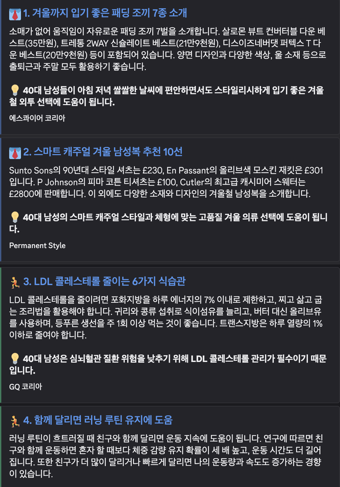
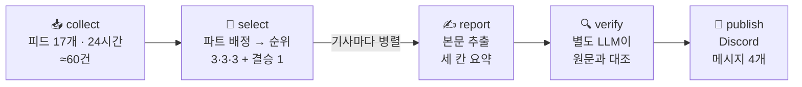
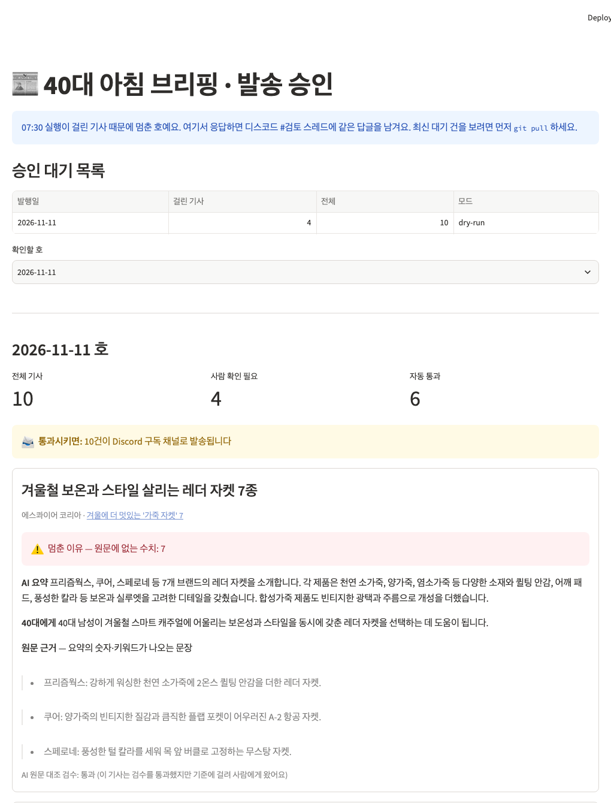

<div align="center">

# 🗞️ 40대 남성 아침 브리핑

**출근 전 5분, 오늘 입고·뛰고·바를 것만 10건.**

매일 아침 7시 30분, 국내외 남성지·러닝지·그루밍 매체 14곳의 새 글을 읽고<br>
40대 남성에게 쓸모 있는 기사만 골라 한국어로 요약해 Discord로 보내 주는 LangGraph 에이전트예요.

[](https://github.com/Lightnine999/my-newsletter-agent/actions/workflows/daily.yml)


[🙋 HITL 보고서](REPORT.md) · [📊 1차 보고서](REPORT-briefing.md) · [📋 요구사항](PRD.md) · [🗂️ 소스 조사](docs/sources.md) · [📰 지난 브리핑](issues/)

</div>

---

## 이런 걸 받아요

<table>
<tr>
<td width="52%" valign="top">



</td>
<td valign="top">

**👔 남성복 3건**<br>
출근·주말 겸용 스마트 캐주얼, 소재·컬러·신발 조합

**🏃 스포츠 3건**<br>
러닝·수영·근력·골프·등산 — 체지방 관리, 관절 보호, 부상 예방, 장비

**🧴 화장품 3건**<br>
안티에이징 성분, 운동 전후 피부, 쉐이빙, 두피, 향수

**➕ 그날 가장 좋은 1건**<br>
세 파트의 다음 후보끼리 겨뤄 이긴 기사가 들어가요

---

카드마다 이렇게 와요.

- **제목** — 누르면 원문으로
- **요약** — 원문에 있는 내용만, 두세 문장
- 💡 **40대에게 왜** — 한 줄
- **매체명**

</td>
</tr>
</table>

## 왜 만들었나

쓸 만한 정보는 Runner's World, Men's Health, GQ 코리아, 에스콰이어 코리아, Permanent Style 같은 곳에 흩어져 있는데, 피드를 열어 보면 대부분이 연예 화보·프로 경기 결과·쇼핑 딜·데이팅 글·1020 트렌드예요. 실제로 재 보니 **24시간에 약 60건이 올라오고, 그중 3분의 1은 40대 독자와 상관없는 글**이었어요. 그걸 매일 대신 걸러 주는 게 이 에이전트의 일이에요.

## 어떻게 10건을 고르나



| 단계 | 하는 일 | 지키는 것 |
|---|---|---|
| 📥 **collect** | RSS·Atom 피드 17개(매체 14곳)에서 24시간 글을 모아요 | 이미 보낸 기사는 빼요 · 막힌 사이트는 우회하지 않아요 |
| 🎯 **select** | 40대 남성 매거진 **편집장 겸 트렌드팀 총괄** 페르소나가 기사마다 파트를 정하고, 파트 안에서 서로 비교해 순위를 매겨요. 배분은 코드가 해요 | 파트당 기본 3건 · 같은 매체는 하루 3건까지 · 모자라는 파트는 다른 파트가 채워요 |
| ✍️ **report** | 원문 본문을 뽑아 제목·요약·40대에게 왜, 세 칸으로 써요 | 본문이 600자 미만이면 빼요 · 영어로 나오면 한 번 다시 써요 |
| 🔍 **verify** | 요약을 쓴 호출과 **다른** LLM 호출이 원문과 대조해요 | 없는 제품·바뀐 숫자는 탈락 → 예비 후보로 교체해요 |
| 📨 **publish** | 오늘 배분 한 줄 + 파트별 카드로 보내요 | 0건인 날도 "오늘은 조용합니다"를 보내 멈춤과 구분해요 |

**선별 기준** ([audience.yaml](audience.yaml)): 오늘 바로 쓸 수 있나 · 40대 몸(대사량·관절·회복·피부 탄력)에 맞나 · 실제로 바뀐 게 있나 · 단기 다이어트보다 오래 가는 습관 · 쇼핑 목록보다 고르는 기준.
코드를 고치지 않고 이 파일만 바꿔서 독자·기준·소스·배분을 조정할 수 있어요.

## 숫자로 보면

| | |
|---|---|
| 검토한 소스 | 22개 항목 → 관문(본문·생존·접근) 통과 **14곳** |
| 하루 처리 | 수집 약 60건 → 발행 **10건** |
| 실행 시간 | 약 1분 (GitHub Actions) |
| 하루 비용 | 약 **$0.03** (토큰 약 5만 개, gpt-4.1-mini) |
| 검수 시험 | 실제 요약 10/10 통과 · 일부러 틀린 요약 3/3 탈락 |
| 테스트 | **62개** · 실제 API·네트워크 없이 0.2초 |

## 매일 아침 자동으로

```
07:30  GitHub Actions 실행 → 테스트 → 브리핑 만들고 보내기 → 보낸 기록 커밋
07:50  예비 실행 (GitHub 스케줄이 밀리거나 빠질 때 대비) — 오늘 이미 보냈으면 건너뜀
08:10  예비 실행
```

못 보내면 Actions가 빨간불이 되고 실패 메일이 와요. 매 실행 기록은 [store/metrics.jsonl](store/metrics.jsonl)에 한 줄씩 쌓여요.

## 🙋 발송 전 사람 승인 (HITL)

> 브랜치 `feat/hitl-discord-approval` · 자세한 내용은 [REPORT.md](REPORT.md)

검수를 통과했어도 **원문에 없는 숫자**가 있거나 **건강·의학 조언**(처방·피부과·통증 등)이 들어간 기사가 있으면, 그날 호는 발송 직전(`approve` 노드)에 멈춰요. 걸린 기사가 없으면 지금처럼 바로 나가요.

```
07:30  daily.yml   기사 생성 → 기준 ①+② 검사 ─ 걸린 것 없음 → 구독 채널 발송
                                             └ 걸림 → interrupt · 비공개 #검토 채널에 승인 요청 카드
08:00~13:30 30분마다  review.yml (run.py --check) → 담당자 응답을 읽어 이어서 발송
12:00 이후 첫 확인  응답이 없으면 걸린 기사만 빼고 발송
```

**응답하는 법** (담당자로 등록한 디스코드 계정의 응답만 인정해요)

| 응답 | 카드 반응 | 스레드 답글 |
|---|---|---|
| 그대로 발송 | ✅ | `승인` |
| 걸린 기사 빼고 발송 | ➖ | `빼고` · `빼고 1,2` |
| **기사별로 정하기** | — | 줄마다 `1 - 승인` · `2 - 보류` · `3,4 - 교체` (걸린 번호를 모두) |
| 문구 고쳐서 발송 | — | `제목 1: 새 제목` · `수정 1: 새 요약` |
| 호 전체 보내지 않기 | ⏸️ | `보류: 사유` |

`교체`는 예비 기사를 새로 요약·검수해 그 자리에 넣어요(그 기사도 기준에 걸리면 빼요). 반응을 여러 개 누르거나, 걸린 번호가 빠졌거나, 형식에 안 맞는 답글은 승인으로 치지 않고 스레드에서 한 번 되물어요. 응답은 다음 확인 실행(최대 30분) 때 반영돼요.

**Streamlit 승인 화면** — 대기 목록 · 멈춘 이유 · 원문 근거 · 승인하면 일어나는 일을 보고, 응답하면 디스코드 스레드에 같은 답글을 대신 달아요.



## 직접 돌려 보기

```bash
git clone https://github.com/Lightnine999/my-newsletter-agent.git && cd my-newsletter-agent
uv venv && uv pip install -r requirements.txt pytest
cp .env.example .env                 # OPENAI_API_KEY, DISCORD_WEBHOOK_URL 채우기
.venv/bin/python -m pytest -q        # 테스트 (네트워크 없이)
.venv/bin/python run.py --dry-run    # 보내지 않고 로그와 output/날짜.md만
DRY_RUN=0 .venv/bin/python run.py    # 실제로 Discord에 보내기
```

**사람 승인까지 시연하기** (로컬 실행이면 충분해요 · 구독 채널로는 안 나가요)

```bash
.venv/bin/python run.py --dry-run    # 1) 걸린 기사가 있으면 멈추고 #검토 채널에 카드가 올라와요
.venv/bin/streamlit run app.py       # 2) http://localhost:8501 → 사이드바 '실제 승인 대기'
.venv/bin/python run.py --check      # 3) 디스코드에 응답한 뒤 실행 → 응답대로 output/날짜.md 발행, 카드 '처리됨'
```

- 디스코드 봇이 없어도 1)·2)는 돌아가요. 이때는 카드가 올라가지 않고, 승인 화면의 **'샘플 (기준 시험)'** 보기로 기준을 바꿔 가며 볼 수 있어요(`scripts/hitl_samples.py`로 샘플 수집).
- 기준 비교표(개입률·놓침·헛멈춤): `.venv/bin/python scripts/hitl_compare.py`

**디스코드 승인을 켜려면** `.env`(로컬)와 저장소 Secrets(Actions)에 네 값을 더 넣어요. 값은 저장소에 올리지 않아요.

| 이름 | 무엇 | 어디서 |
|---|---|---|
| `DISCORD_BOT_TOKEN` | 봇 토큰 | Developer Portal → Bot → Reset Token (**Message Content Intent 켜기**) |
| `DISCORD_REVIEW_CHANNEL_ID` | **비공개** 검토 채널 ID (구독 채널과 다른 채널) | 개발자 모드 → 채널 우클릭 → ID 복사 |
| `DISCORD_REVIEWER_ID` | 승인할 사람의 디스코드 사용자 ID | 개발자 모드 → 내 이름 우클릭 → ID 복사 |
| `HITL_STATE_KEY` | 멈춘 지점 암호화 키 | `.venv/bin/python -c "from cryptography.fernet import Fernet; print(Fernet.generate_key().decode())"` |

봇은 서버에 초대만 하면 돼요(권한: 채널 보기 · 메시지 보내기 · 스레드에서 메시지 보내기 · 공개 스레드 만들기 · 메시지 기록 보기 · 반응 추가). **켜 둘 필요가 없어요** — 실행될 때만 REST로 카드를 올리고 응답을 읽어요.

내 저장소에서 매일 받으려면 저장소 Settings → Secrets에 `OPENAI_API_KEY`·`DISCORD_WEBHOOK_URL` 두 개를 넣으면 돼요. `.env`가 있다면 `bash scripts/set_secrets.sh` 한 줄로 등록돼요.

## 폴더 구조

```
my-newsletter-agent/
├── graph.py              # LangGraph State · 노드 여섯 개(approve 포함) · run() · resume() · pending()
├── run.py                # 실행 진입점 (중복 발송 방지 · 승인 대기 · --check 이어 가기 · metrics)
├── hitl.py               # 멈춤 기준 ①② · Decision · 답글 문법 · 반응 · 정오 규칙
├── hitl_store.py         # 체크포인트 암호화 저장·복원 · 승인 대기 기록
├── discord_review.py     # 디스코드 봇 REST (카드 · 반응 · 스레드 · 응답 읽기)
├── app.py                # Streamlit 승인 화면
├── audience.yaml         # 독자 · 파트 · 10건 배분 · 기준 · 제외 조건 · 소스 17개
├── requirements.txt      # 의존성
├── store/
│   ├── metrics.jsonl     # 실행마다 한 줄: 수집·배분·제외 이유·결과·토큰·비용
│   ├── sent.jsonl        # 보낸 기사 주소 (다음 날 중복 제외)
│   ├── reviews.jsonl     # 승인 대기 기록 (날짜 · 상태 · 카드 번호, 본문 없음)
│   └── checkpoints.enc   # 멈춘 지점 (암호화 — 원문이 보이지 않아요)
├── issues/               # 보낸 브리핑 사본 (날짜.md)
├── REPORT.md             # HITL 보고서 (REPORT-briefing.md = 1차 보고서)
├── PRD.md · docs/        # 요구사항 · 진행 기록 · 소스 조사
├── scripts/              # HITL 샘플 수집 · 기준 비교표
├── tests/                # 테스트 122개
└── .github/workflows/    # daily.yml (07:30) · review.yml (승인 확인 30분마다)
```

## 더 읽을거리

- **[REPORT.md](REPORT.md)** — HITL: 주제, 멈춤·재개 구조도, 승인 기준, 실행 결과, 승인 화면 설계, 회고
- [REPORT-briefing.md](REPORT-briefing.md) — 1차: 분야·독자 정의, 소스 채택표(측정값), 선별 로직, 구조도, 실행 기록, 회고
- [docs/hitl-plan.md](docs/hitl-plan.md) — HITL 설계와 결정 기록
- [docs/sources.md](docs/sources.md) — 자료를 가져오는 다섯 길 비교와 소스 관문 측정
- [docs/plan.md](docs/plan.md) — 1부~7부를 만들며 실측하고 고친 기록
- [ai-newsletter-agent](https://github.com/Lightnine999/ai-newsletter-agent) — 같은 구조로 먼저 만든 AI 소식 브리핑

<sub>AIFFEL 노드 "매일 아침 소식을 골라 보내는 뉴스레터 에이전트"를 따라 주제를 바꿔 만들었어요. 소스 원본 명세와 교재는 저장소에 올리지 않고 로컬에만 둬요.</sub>
