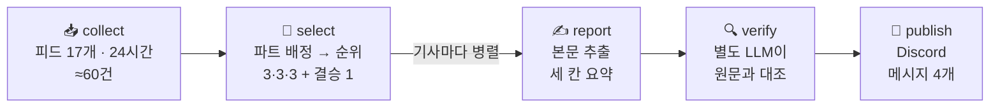

<div align="center">

# 🗞️ 40대 남성 아침 브리핑

**출근 전 5분, 오늘 입고·뛰고·바를 것만 10건.**

매일 아침 7시 30분, 국내외 남성지·러닝지·그루밍 매체 14곳의 새 글을 읽고<br>
40대 남성에게 쓸모 있는 기사만 골라 한국어로 요약해 Discord로 보내 주는 LangGraph 에이전트예요.

[](https://github.com/Lightnine999/my-newsletter-agent/actions/workflows/daily.yml)


[📊 수행 결과 보고서](REPORT.md) · [📋 요구사항](PRD.md) · [🗂️ 소스 조사](docs/sources.md) · [📰 지난 브리핑](issues/)

</div>

---

## 이런 걸 받아요

<table>
<tr>
<td width="52%" valign="top">


</td>
<td valign="top">

**👔 남성복 3건**<br>
출근·주말 겸용 스마트 캐주얼, 소재·컬러·신발 조합

**🏃 스포츠 3건**<br>
러닝·수영·근력·골프·등산 — 체지방 관리, 관절 보호, 부상 예방, 장비

**🧴 화장품 3건**<br>
안티에이징 성분, 운동 전후 피부, 쉐이빙, 두피, 향수

**➕ 그날 가장 좋은 1건**<br>
세 파트의 다음 후보끼리 겨뤄 이긴 기사가 들어가요

---

카드마다 이렇게 와요.

- **제목** — 누르면 원문으로
- **요약** — 원문에 있는 내용만, 두세 문장
- 💡 **40대에게 왜** — 한 줄
- **매체명**

</td>
</tr>
</table>

## 왜 만들었나

쓸 만한 정보는 Runner's World, Men's Health, GQ 코리아, 에스콰이어 코리아, Permanent Style 같은 곳에 흩어져 있는데, 피드를 열어 보면 대부분이 연예 화보·프로 경기 결과·쇼핑 딜·데이팅 글·1020 트렌드예요. 실제로 재 보니 **24시간에 약 60건이 올라오고, 그중 3분의 1은 40대 독자와 상관없는 글**이었어요. 그걸 매일 대신 걸러 주는 게 이 에이전트의 일이에요.

## 어떻게 10건을 고르나



| 단계 | 하는 일 | 지키는 것 |
|---|---|---|
| 📥 **collect** | RSS·Atom 피드 17개(매체 14곳)에서 24시간 글을 모아요 | 이미 보낸 기사는 빼요 · 막힌 사이트는 우회하지 않아요 |
| 🎯 **select** | 40대 남성 매거진 **편집장 겸 트렌드팀 총괄** 페르소나가 기사마다 파트를 정하고, 파트 안에서 서로 비교해 순위를 매겨요. 배분은 코드가 해요 | 파트당 기본 3건 · 같은 매체는 하루 3건까지 · 모자라는 파트는 다른 파트가 채워요 |
| ✍️ **report** | 원문 본문을 뽑아 제목·요약·40대에게 왜, 세 칸으로 써요 | 본문이 600자 미만이면 빼요 · 영어로 나오면 한 번 다시 써요 |
| 🔍 **verify** | 요약을 쓴 호출과 **다른** LLM 호출이 원문과 대조해요 | 없는 제품·바뀐 숫자는 탈락 → 예비 후보로 교체해요 |
| 📨 **publish** | 오늘 배분 한 줄 + 파트별 카드로 보내요 | 0건인 날도 "오늘은 조용합니다"를 보내 멈춤과 구분해요 |

**선별 기준** ([audience.yaml](audience.yaml)): 오늘 바로 쓸 수 있나 · 40대 몸(대사량·관절·회복·피부 탄력)에 맞나 · 실제로 바뀐 게 있나 · 단기 다이어트보다 오래 가는 습관 · 쇼핑 목록보다 고르는 기준.
코드를 고치지 않고 이 파일만 바꿔서 독자·기준·소스·배분을 조정할 수 있어요.

## 숫자로 보면

| | |
|---|---|
| 검토한 소스 | 22개 항목 → 관문(본문·생존·접근) 통과 **14곳** |
| 하루 처리 | 수집 약 60건 → 발행 **10건** |
| 실행 시간 | 약 1분 (GitHub Actions) |
| 하루 비용 | 약 **$0.03** (토큰 약 5만 개, gpt-4.1-mini) |
| 검수 시험 | 실제 요약 10/10 통과 · 일부러 틀린 요약 3/3 탈락 |
| 테스트 | **62개** · 실제 API·네트워크 없이 0.2초 |

## 매일 아침 자동으로

```
07:30  GitHub Actions 실행 → 테스트 → 브리핑 만들고 보내기 → 보낸 기록 커밋
07:50  예비 실행 (GitHub 스케줄이 밀리거나 빠질 때 대비) — 오늘 이미 보냈으면 건너뜀
08:10  예비 실행
```

못 보내면 Actions가 빨간불이 되고 실패 메일이 와요. 매 실행 기록은 [store/metrics.jsonl](store/metrics.jsonl)에 한 줄씩 쌓여요.

## 직접 돌려 보기

```bash
git clone https://github.com/Lightnine999/my-newsletter-agent.git && cd my-newsletter-agent
uv venv && uv pip install -r requirements.txt pytest
cp .env.example .env                 # OPENAI_API_KEY, DISCORD_WEBHOOK_URL 채우기
.venv/bin/python -m pytest -q        # 테스트 (네트워크 없이)
.venv/bin/python run.py --dry-run    # 보내지 않고 로그와 output/날짜.md만
DRY_RUN=0 .venv/bin/python run.py    # 실제로 Discord에 보내기
```

내 저장소에서 매일 받으려면 저장소 Settings → Secrets에 `OPENAI_API_KEY`·`DISCORD_WEBHOOK_URL` 두 개를 넣으면 돼요. `.env`가 있다면 `bash scripts/set_secrets.sh` 한 줄로 등록돼요.

## 폴더 구조

```
my-newsletter-agent/
├── graph.py              # LangGraph State · 노드 다섯 개 · build() · run()
├── run.py                # 실행 진입점 (중복 발송 방지 · 실패 시 exit 1 · metrics 기록)
├── audience.yaml         # 독자 · 파트 · 10건 배분 · 기준 · 제외 조건 · 소스 17개
├── requirements.txt      # 의존성
├── store/
│   ├── metrics.jsonl     # 실행마다 한 줄: 수집·배분·제외 이유·결과·토큰·비용
│   └── sent.jsonl        # 보낸 기사 주소 (다음 날 중복 제외)
├── issues/               # 보낸 브리핑 사본 (날짜.md)
├── REPORT.md             # 수행 결과 보고서
├── PRD.md · docs/        # 요구사항 · 진행 기록 · 소스 조사
├── tests/                # 테스트 62개
└── .github/workflows/daily.yml
```

## 더 읽을거리

- **[REPORT.md](REPORT.md)** — 분야·독자 정의, 소스 채택표(측정값), 선별 로직, 구조도, 실행 기록, 회고
- [docs/sources.md](docs/sources.md) — 자료를 가져오는 다섯 길 비교와 소스 관문 측정
- [docs/plan.md](docs/plan.md) — 1부~7부를 만들며 실측하고 고친 기록
- [ai-newsletter-agent](https://github.com/Lightnine999/ai-newsletter-agent) — 같은 구조로 먼저 만든 AI 소식 브리핑

<sub>AIFFEL 노드 "매일 아침 소식을 골라 보내는 뉴스레터 에이전트"를 따라 주제를 바꿔 만들었어요. 소스 원본 명세와 교재는 저장소에 올리지 않고 로컬에만 둬요.</sub>
