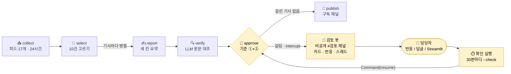

<div align="center">

# 🙋 발송 전 사람 승인 (HITL) · 40대 아침 브리핑

**위험한 기사가 섞인 날만 멈추고, 사람이 디스코드에서 답하면 이어서 보내요.**

매일 07:30 자동으로 나가던 디스코드 뉴스레터에 **승인 노드(`approve`)와 검토 봇**을 붙였어요.<br>
걸린 기사가 없으면 그대로 나가고, 걸리면 비공개 채널에 승인 요청을 올린 뒤 **서버 없이** 응답을 기다려요.


[📊 HITL 보고서](REPORT.md) · [🧭 설계 기록](docs/hitl-plan.md) · [🗞️ 1차 보고서 (자동 발송 브리핑)](REPORT-briefing.md)

</div>

---

## 파이프라인

색칠한 칸이 이번에 추가한 공정이에요. 나머지 다섯 칸은 1차 브리핑 그대로예요.



| 추가한 공정 | 하는 일 |
|---|---|
| 🙋 **approve** (그래프 노드) | 검수를 통과한 기사를 기준 ①②로 검사해요. 걸리면 `interrupt`로 **발송 직전에 멈춰요**. 재개되면 응답대로 빼고·고치고·교체한 뒤 publish로 넘겨요 |
| 🤖 **검토 봇** (디스코드) | 멈춘 호를 비공개 채널에 카드로 올리고(@멘션 · 반응 ✅ ➖ ⏸️ · 스레드), 담당자의 반응·답글을 읽고, 처리 결과를 카드에 표시해요. **켜 둘 필요 없이** 실행될 때만 REST로 동작해요 |
| ⏱️ **확인 실행** (Actions `review.yml`) | 30분마다 깨어나 응답을 읽고 `Command(resume=Decision)`으로 이어 가요. 정오가 지나도 응답이 없으면 걸린 기사만 빼고 보내요 |
| 🔐 **멈춘 지점 보관** | 실행과 실행 사이에 `SqliteSaver` 체크포인트를 **암호화**해 저장소에 둬요(공개 저장소라 원문이 보이면 안 돼요) |

## 멈춤 기준

| # | 기준 | 대비하는 위험 |
|---|---|---|
| ① | 요약의 숫자가 원문에 없음 | 검수를 통과한 **환각 수치** (가격·횟수·기간) |
| ② | 건강·의학 키워드 (`처방` `피부과` `통증` `혈압` `보충제` …) | 사실이어도 **따라 하면 위험한 조언** |

숫자가 원문과 맞고 건강 조언이 아닌 기사(옷·장비·운동 팁)는 사람을 거치지 않고 나가요. 기준은 샘플에 정답을 달아 개입률·헛멈춤을 비교해 골랐어요([REPORT §3](REPORT.md#3-승인-기준과-그-이유)).

**실제 실행** — 2026-11-10: 10건 중 2건 멈춤 → 정오 규칙으로 8건 · 2026-11-11: 10건 중 4건 멈춤(처방약·호르몬 치료 기사 포함) → 디스코드 `승인`으로 재개해 10건

## 승인 화면


걸린 기사마다 **멈춘 이유 · AI 요약 · 원문 근거 문장 · 원문 링크**, 그리고 **승인하면 일어나는 일**을 한 화면에 둬요. Streamlit에서 답하면 디스코드 스레드에 같은 답글을 대신 달아서, 응답 창구가 하나로 모여요.

## 응답하는 법

담당자로 등록한 디스코드 계정의 응답만 인정해요.

| 응답 | 카드 반응 | 스레드 답글 |
|---|---|---|
| 그대로 발송 | ✅ | `승인` |
| 걸린 기사 빼고 발송 | ➖ | `빼고` · `빼고 1,2` |
| **기사별로 정하기** | — | 줄마다 `1 - 승인` · `2 - 보류` · `3,4 - 교체` (걸린 번호를 모두) |
| 문구 고쳐서 발송 | — | `제목 1: 새 제목` · `수정 1: 새 요약` |
| 호 전체 보내지 않기 | ⏸️ | `보류: 사유` |

- `교체`는 예비 기사를 새로 요약·검수해 그 자리에 넣고, 그 기사도 기준에 걸리면 빼요.
- 반응을 여러 개 누르거나, 번호가 빠졌거나, 형식에 안 맞으면 **승인으로 치지 않고** 스레드에서 한 번 되물어요.

## 실행해 보기

```bash
git clone -b feat/hitl-discord-approval https://github.com/Lightnine999/my-newsletter-agent.git && cd my-newsletter-agent
uv venv && uv pip install -r requirements.txt pytest
cp .env.example .env                 # OPENAI_API_KEY 채우기 (디스코드 값은 아래 표)
.venv/bin/python -m pytest -q        # 테스트 122개 · 네트워크 없이
```

**사람 승인 시연** — dry-run이라 구독 채널로는 아무것도 나가지 않아요

```bash
.venv/bin/python run.py --dry-run    # 1) 걸린 기사가 있으면 멈추고 검토 봇이 카드를 올려요
.venv/bin/streamlit run app.py       # 2) localhost:8501 → '실제 승인 대기'
.venv/bin/python run.py --check      # 3) 디스코드에 답한 뒤 → 응답대로 output/날짜.md, 카드 '처리됨'
```

디스코드 봇이 없어도 1)·2)는 돌아가요. 기준을 바꿔 보려면 화면의 **'샘플 (기준 시험)'** 보기, 기준 비교표는 `scripts/hitl_compare.py`예요.

**검토 봇 켜기** — `.env`(로컬)와 저장소 Secrets(Actions)에 넣어요. 값은 저장소에 올리지 않아요.

| 이름 | 무엇 |
|---|---|
| `DISCORD_BOT_TOKEN` | 봇 토큰 (Developer Portal → Bot · **Message Content Intent 켜기**) |
| `DISCORD_REVIEW_CHANNEL_ID` | **비공개** 검토 채널 ID — 구독 채널과 다른 채널 |
| `DISCORD_REVIEWER_ID` | 승인할 사람의 디스코드 사용자 ID |
| `HITL_STATE_KEY` | 멈춘 지점 암호화 키: `.venv/bin/python -c "from cryptography.fernet import Fernet; print(Fernet.generate_key().decode())"` |

봇 권한: 채널 보기 · 메시지 보내기 · 스레드 메시지 · 공개 스레드 만들기 · 기록 보기 · 반응 추가. 구독 채널 발송은 기존 `DISCORD_WEBHOOK_URL` 그대로예요.

## 구조

🆕 = 이번 과제에서 만든 것 · ✏️ = 고친 것 · 표시 없음 = 1차 그대로

```
├── hitl.py              🆕 멈춤 기준 ①② · Decision · 답글 문법(기사별 포함) · 반응 · 정오 규칙
├── hitl_store.py        🆕 체크포인트 암호화 저장·복원 · 승인 대기 기록
├── discord_review.py    🆕 검토 봇 REST (카드 · 반응 · 스레드 · 응답 읽기 · 처리 표시)
├── app.py               🆕 Streamlit 승인 화면 (실제 대기 건 · 샘플 기준 시험)
├── graph.py             ✏️ approve 노드(interrupt) · resume() · pending() · 교체 채우기
├── run.py               ✏️ 승인 대기 처리 · --check 확인 모드
├── scripts/             🆕 hitl_samples.py · hitl_compare.py (기준 검증)
├── tests/               🆕 HITL 테스트 60개 추가 (전체 122개)
├── .github/workflows/   🆕 review.yml (30분마다 확인) · ✏️ daily.yml (07:30)
├── store/               🆕 reviews.jsonl · checkpoints.enc(암호화) · metrics.jsonl · sent.jsonl
├── audience.yaml        독자 · 파트 · 배분 · 선별 기준 · 소스 17개
└── REPORT.md            🆕 HITL 보고서 · REPORT-briefing.md = 1차 보고서
```

<details>
<summary>기반 파이프라인(1차)은 어떻게 동작하나요?</summary>

매일 07:30, 남성지·러닝지·그루밍 매체 14곳(피드 17개)의 24시간 글 약 60건을 모아, 40대 남성 매거진 편집장 페르소나가 남성복·스포츠·화장품 3건씩 + 결승 1건을 고르고, 기사마다 세 칸(제목·요약·40대에게 왜)으로 요약한 뒤, 다른 LLM 호출이 원문과 대조해 틀린 요약을 예비 후보로 바꿔요. 하루 약 1분 · 약 $0.03. 소스 채택표, 선별 로직, 검증 기록은 [1차 보고서](REPORT-briefing.md)에 있어요.

</details>

<sub>AIFFEL 노드 "HITL"을 따라, 1차 과제로 만든 40대 남성 아침 브리핑에 사람 승인 단계를 붙였어요. 기사 원문·교재는 저장소에 올리지 않아요.</sub>
