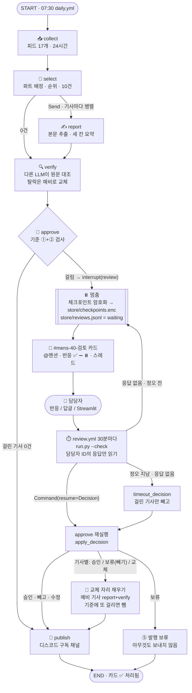
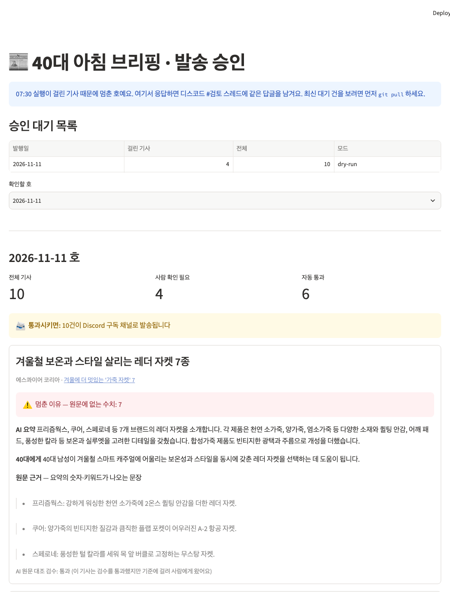
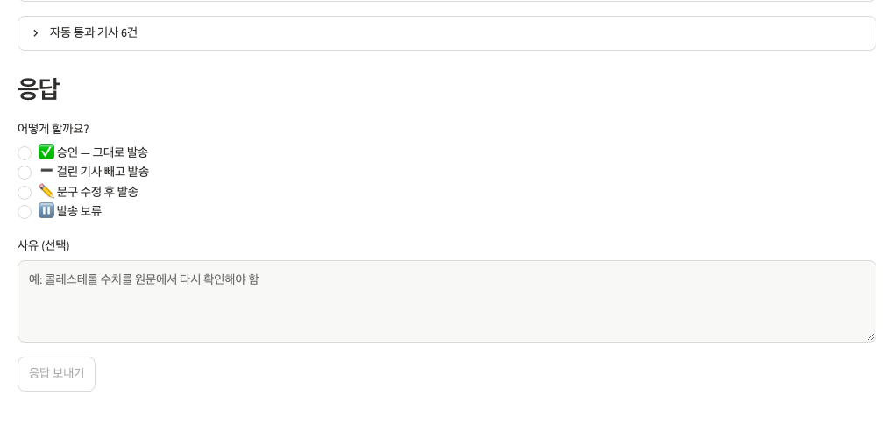

# REPORT · 40대 남성 아침 브리핑 — 발송 전 사람 승인(HITL)

> 매일 07:30 자동으로 나가던 디스코드 브리핑에, **위험한 기사가 섞인 날만 사람이 보고 보내는 승인 단계**를 붙였어요.
> 걸린 기사가 없으면 지금처럼 바로 나가고, 걸리면 그래프가 멈춰 비공개 검토 채널에 승인 요청 카드를 올려요. 사람이 디스코드 반응·답글이나 Streamlit 화면으로 답하면 멈춘 자리에서 이어서 발송해요.
> 저장소: https://github.com/Lightnine999/my-newsletter-agent (브랜치 `feat/hitl-discord-approval`) · 1차 과제 보고서: [REPORT-briefing.md](REPORT-briefing.md) · 설계 기록: [docs/hitl-plan.md](docs/hitl-plan.md)

| 항목 | 결과 |
|---|---|
| 멈추는 자리 | `verify` → **`approve`** → `publish` (발송 직전) |
| 승인 단위 | 호 단위 (`thread_id` = 발행일). 걸린 기사는 강조해서 보여 줘요 |
| 멈춤 기준 | ① 원문에 없는 수치 · ② 건강·의학 키워드 |
| 응답 창구 | 디스코드 비공개 채널(반응 ✅ ➖ ⏸️ · 스레드 답글, 기사별 `1 - 승인`·`2 - 보류`·`3 - 교체`) + Streamlit 승인 화면 |
| 서버 | **없음** — GitHub Actions가 30분마다 깨어나 응답을 읽고, 멈춘 지점은 암호화 파일로 저장소에 둬요 |
| 테스트 | 122개 (실제 API·디스코드·네트워크 없이) |

---

## 1. 주제와 고른 이유

**자동화한 업무**: 남성지·러닝지·그루밍 매체 14곳의 새 글을 모아, 40대 남성에게 쓸모 있는 10건을 골라 한국어로 요약하고 디스코드 구독 채널로 보내는 일이에요 ([1차 보고서](REPORT-briefing.md)).

**결과가 바깥으로 나가는 단계**: 마지막 `publish` 노드가 디스코드 웹훅으로 보내는 순간이에요. **디스코드로 나간 메시지는 되돌릴 수 없어요.** 구독자가 이미 읽었을 수 있거든요.

**왜 여기에 사람을 넣었나**
- 1차 버전에도 `verify`(다른 LLM이 원문과 대조하는 검수)가 있었지만, 검수 LLM도 100%가 아니에요. 검수를 통과한 오류는 그대로 구독자에게 나가요.
- 특히 위험한 건 두 가지예요. **틀린 숫자**(가격·횟수·기간), 그리고 사실은 맞아도 독자가 따라 하면 위험한 **건강·의학 조언**(처방약, 호르몬 치료)이에요.
- 그렇다고 매일 10건을 다 사람이 보면 자동화한 의미가 없어요. 그래서 **기준에 걸린 날만 멈추고, 나머지는 지금처럼 자동으로** 보내기로 했어요.

## 2. 파이프라인 구조도

**상태(State) 흐름** — [graph.py](graph.py) `Brief`

| 칸 | 누가 채우나 | 쓰임 |
|---|---|---|
| `collected` → `picked`·`spares` | collect → select | 수집한 기사, 고른 10건, 예비 후보 |
| `drafted` (리듀서 `add`) | report 워커들 | 병렬로 쓴 세 칸 요약 (원문 `body` 포함) |
| `verified` | verify → **approve** | 검수 통과 기사. approve가 응답대로 빼거나 고치거나, '교체'한 자리에 예비 기사를 넣은 목록으로 바꿔요 |
| `spares` | select → **approve** | 교체할 때 쓸 예비 후보. 이미 실렸거나 방금 뺀 기사는 다시 쓰지 않아요 |
| `held` | **approve** | 보류 사유. 값이 있으면 publish가 아무것도 보내지 않아요 |
| `date` | run() | 발행일 = `thread_id`. 승인을 기다리다 날이 바뀌어도 같은 호로 발행해요 |
| `log` (리듀서 `add`) | 모든 노드 | 실행 기록 → Actions 로그 · metrics |

**멈춤과 재개에서 지킨 것**
- `approve`는 재개될 때 **처음부터 다시 실행**돼요(LangGraph `interrupt`의 동작). 그래서 `interrupt` 앞에서는 바깥으로 아무것도 보내지 않아요. 디스코드 카드는 그래프가 멈춘 걸 확인한 뒤 `run.py`가 올려요. 두 번 올라가는 일을 막기 위해서예요.
- 07:30 실행과 30분 확인 실행은 **다른 컴퓨터**(Actions)에서 돌아요. 멈춘 지점을 이어 가려고 `SqliteSaver` 체크포인트를 `HITL_STATE_KEY`(Fernet)로 암호화해 저장소에 커밋해요. 공개 저장소라 원문 본문이 보이면 안 되기 때문이에요. 처리가 끝난 호는 체크포인트에서 지워요.
- 담당자 응답은 `hitl.Decision`(pydantic)으로 검증한 뒤 `Command(resume=...)`로 넣어요. 빼고 보내기는 뺄 기사가, 수정은 고친 내용이, 보류는 사유가 있어야 하고, 기사별 응답은 한 기사에 보류와 교체를 함께 고를 수 없어요.

## 3. 승인 기준과 그 이유

| # | 기준 | 계산 | 대비하는 위험 |
|---|---|---|---|
| ① | **원문에 없는 수치** | 제목·요약의 숫자가 원문 `body`에 없으면 멈춤. 쉼표 제거, `3만`→30000, `40대`는 독자 표현이라 제외. 영어 원문의 `three`·`1930s`도 숫자로 봐요 | LLM 검수를 통과한 **환각 수치** (가격·횟수·기간) |
| ② | **건강·의학 키워드** | 제목·요약에 `콜레스테롤 혈압 혈당 질환 효능 복용 의사 피부과 통증 약물 보충제 처방`이 있으면 멈춤 | 사실은 맞아도 **따라 하면 위험한 조언** (약·치료·질환) |

**자동으로 나가는 건** — 숫자가 원문과 맞고 건강 조언이 아닌 기사예요. 이미 LLM 검수를 통과했고, 틀려도 독자가 입는 피해가 작아요. 2026-11-11 호에서 자동으로 나간 예:
- "겨울 출근·주말에 좋은 하이넥 코트 7종" — 개수 `7`과 가격 5개(299,620원·382,500원 등)가 모두 원문과 일치해 통과
- "운동용 무선 헤드폰 11종 추천과 선택 기준", "스마트폰 없이 10분 전신 근력 운동법", "고전과 현대를 잇는 하이 앤 타이트 헤어컷"

**기준을 고른 과정** (교안 3장: 개입률 · 놓침 · 헛멈춤) — [scripts/hitl_compare.py](scripts/hitl_compare.py)

1. 지난 3호 요약 29건으로 처음 재 보니, "숫자가 있으면 멈춤"은 **29건 중 20건**이 걸렸어요. 헛멈춤이 너무 많아서 "원문에 **없는** 숫자"로 좁혔어요.
2. 원문까지 담은 샘플 12건(2026-11-10)을 모아 기사마다 "사람이 봐야 하나"를 직접 표시했어요(정답 12건 모두 n). 처음 키워드에 있던 `부상`이 **4건을 헛멈춤**시켰어요. 운동 기사에는 "부상 예방"이 늘 들어가거든요. 사용자 결정으로 `부상`·`치료`를 빼서, 부상 예방·치료 기사는 통과시키기로 했어요.
3. 최종 기준 ①+②로 다시 재면 샘플 12건 중 멈춤 0건이에요.

| 기준 (샘플 12건) | 멈춤 | 개입률 | 헛멈춤 |
|---|---|---|---|
| 전부 멈춤 | 12 | 100% | 12 |
| 숫자가 있으면 | 10 | 83% | 10 |
| ① 원문에 없는 수치 | 0 | 0% | 0 |
| ② 건강·의학 키워드 (`부상` 포함 시) | 4 | 33% | 4 |
| **①+② (최종)** | **0** | **0%** | **0** |

> 놓침(멈춰야 하는데 통과한 건)은 이 샘플에 "봐야 하는 기사"가 없어서 재지 못했어요. 대신 아래 실제 실행에서 처방약·호르몬 치료 기사가 걸린 것으로 기준이 위험한 기사를 잡는 것을 확인했어요.

## 4. 실행 결과

실제 피드·실제 OpenAI로 돌리고, 실제 디스코드 비공개 채널에서 응답했어요. 구독 채널로 나가지 않게 dry-run으로 했어요(발행본은 `output/날짜.md`).

| 호 | 처리 | 멈춤 | 멈춘 기사와 판단 | 사람이 한 일 → 결과 |
|---|---|---|---|---|
| 2026-11-10 | 10건 | **2건** | 헤어케어 "주 2~3회"(①, 헛멈춤) · 레더 자켓 "7종"(①, 헛멈춤) | 스레드에 `지금 2건 승인`이라고 답함 → 형식이 아니라서 **승인으로 치지 않고 한 번 되물음** → 정오까지 형식에 맞는 응답이 없어 **정오 규칙**으로 걸린 2건 빼고 **8건 발행** |
| 2026-11-11 | 10건 | **4건** | 레더 자켓 "7종"(①, 헛멈춤) · 여드름 관리 `처방`(②, **멈춰야 할 건** — 처방약 사용 권유) · TRT 중 여드름 `피부과`(②, **멈춰야 할 건** — 호르몬 치료) · 러너 회복법 `통증`(②, 애매) | 담당자가 4건을 읽어 보고 **전부 내보내기로 판단**. 스레드에 `1,2,3,4 승인 - 모두 올려줘` → 형식이 아니라 응답으로 치지 않음 → `승인` 한 줄 추가 → 확인 실행이 **디스코드 응답으로 재개**해 **10건 발행**, 카드 "✅ 처리됨 · 승인 (디스코드)" |

**확인한 동작**
- 걸린 기사가 있으면 발행 전에 멈추고(`publish` 로그 없음), 비공개 채널에 카드 + 반응 3개 + 스레드 + @멘션이 올라가요.
- 담당자 ID가 아닌 사람의 반응·답글은 무시해요. 반응이 여러 개거나 답글을 알아들을 수 없으면 **승인으로 치지 않고** 스레드에 한 번만 되물어요.
- 처리 후 카드 첫 줄이 "✅ **처리됨** · 걸린 기사 빼고 발송 (정오 규칙) · 결과 dry-run"으로 바뀌고, 스레드에 결과가 남아요.
- 실제 Actions 환경과 같은 조건으로, 첫 실행이 만든 암호화 파일만으로 다음 실행이 멈춘 호를 이어 가는 것을 테스트로 확인했어요([tests/test_hitl_store.py](tests/test_hitl_store.py)).

## 5. 데모 화면 설계

교안 4장의 원칙 — **담당자가 10초 안에 판단할 수 있게**, 원문 · 에이전트의 판단과 근거 · 멈춘 이유 · 승인하면 일어나는 일을 한 화면에.

### Streamlit 승인 화면 ([app.py](app.py) · `streamlit run app.py`)

응답 영역 캡처는 '🧩 기사별로 정하기'(기사마다 승인·보류·교체)를 추가하기 전에 찍었어요. 지금은 응답이 5가지예요.

전체 화면: [docs/images/hitl-approval-screen.png](docs/images/hitl-approval-screen.png)

### 디스코드 검토 카드 (`#mens-40-검토`, 비공개)

2026-11-11 호를 처리한 뒤의 화면이에요. 카드 첫 줄이 "✅ 처리됨 · 승인 (디스코드) · 결과 dry-run"으로 바뀌었고, 걸린 기사마다 멈춘 이유 · AI 요약 · 원문 근거가 붙어 있어요. 스레드 아래에는 담당자 답글(`1,2,3,4 승인 - 모두 올려줘` → `승인`)과 봇의 처리 결과("승인 (디스코드) · 결과 dry-run")가 남아요.

카드 한 장에 담은 것: 담당자 @멘션 · 걸린 기사 수 / 전체 · "승인하면: 10건이 Discord 구독 채널로 발송됩니다" · "정오까지 응답이 없으면 걸린 기사만 빼고 발송" · 답하는 법, 그리고 걸린 기사마다 빨간 카드(번호와 제목 = 원문 링크 · ⚠️ 멈춘 이유 · AI 요약 · 원문 근거 인용 · 매체와 원제).

**디스코드에서 답하는 법** (담당자 계정의 반응·답글만 인정)

| 응답 | 카드 반응 | 스레드 답글 |
|---|---|---|
| 그대로 발송 | ✅ | `승인` |
| 걸린 기사 빼고 발송 | ➖ | `빼고` · `빼고 1,2` |
| **기사별로 정하기** | — | 줄마다 `1 - 승인` · `2 - 보류` · `3,4 - 교체` (걸린 번호를 **모두** 적어요) |
| 문구 고쳐서 발송 | — | `제목 1: 새 제목` · `수정 1: 새 요약` |
| 호 전체 보내지 않기 | ⏸️ | `보류: 사유` |

- `보류`(기사별)는 그 기사만 빼요. `교체`는 예비 기사를 새로 요약·검수해서 그 자리에 넣고, 넣은 기사가 또 기준에 걸리면 빼고 보내요.
- 걸린 번호가 빠지거나, 없는 번호거나, 한 번호에 답이 두 개면 응답으로 치지 않고 "2, 4번은 어떻게 할까요?"처럼 구체적으로 되물어요.

### 보여 주기로 한 것

| 무엇 | 어디에 | 왜 |
|---|---|---|
| 승인 대기 목록 (발행일 · 걸린 기사 수 · 전체 · 모드) | 화면 맨 위 표 | 여러 호가 밀렸을 때 무엇부터 볼지 |
| **멈춘 이유** — 어느 숫자가 원문에 없는지, 어느 키워드인지 | 카드마다 빨간 줄 | "왜 나한테 왔나"를 바로 알게 |
| AI 요약 · 40대에게 왜 | 카드 본문 | 실제로 구독자가 받을 문장 |
| **원문 근거** — 요약의 숫자·키워드가 나오는 원문 문장 최대 3개 | 카드 아래 인용 | 원문을 따로 열지 않고 대조. 영어 원문이라 키워드는 영어 어간(`prescri`, `dermatolog`)으로도 찾아요 |
| 원문 링크 · 매체 | 카드 제목 아래 | 근거가 부족하면 바로 원문으로 |
| **승인하면 일어나는 일** — "10건이 Discord 구독 채널로 발송됩니다" | 노란 경고 | 되돌릴 수 없는 행동임을 누르기 전에 |
| 응답 5가지 — 승인 / 걸린 기사 빼고 / 문구 수정 / 보류(사유 필수) / **기사별로 정하기**(기사마다 승인·보류·교체) | 화면 맨 아래 | 교안의 승인·수정 후 승인·반려·다시 판정을 뉴스레터에 맞게. 보류 사유는 다음에 기준을 고칠 재료. '교체'가 교안의 "다시 판정"에 해당해요 |
| 정오까지 응답이 없으면 어떻게 되는지 | 디스코드 카드 | 사람이 바쁠 때도 결과를 예측할 수 있게 |

### 뺀 것

| 무엇 | 왜 뺐나 |
|---|---|
| 원문 전체 | 너무 길어서 10초 판단을 방해해요. 근거 문장 3개 + 링크로 대신해요 (저작권상 저장소에도 올리지 않아요) |
| 자동 통과 기사의 상세 | 판단할 필요가 없는 기사예요. 접힌 목록에 제목만 둬요 |
| 검수 LLM의 판정 상세 | 걸린 기사는 모두 검수를 통과한 것이라 "검수 통과" 한 줄로 충분해요 |
| 토큰·비용·실행 시간 | 승인 판단과 상관없어요. metrics에만 남겨요 |
| 응답의 **기본 선택값** | 처음엔 "승인"이 기본이었는데, 기준을 바꾸려고 화면을 다시 그리자 선택이 "승인"으로 돌아가 **보류하려던 호가 승인으로 기록된 일**이 있었어요. 아무것도 고르지 않으면 버튼이 눌리지 않게 바꿨어요 |
| 실제 대기 건 화면의 기준 선택 | 실행과 다른 기준으로 보면 혼란스러워요. 기준 비교는 "샘플(기준 시험)" 보기로 분리했어요 |
| 디스코드 버튼(컴포넌트) | 버튼은 3초 안에 응답할 서버가 필요해요. 서버 없이 가려고 **반응과 스레드 답글**로 대신했어요 |

Streamlit에서 응답하면 그 응답을 **디스코드 스레드에 같은 형식의 답글로** 대신 달아요(`hitl.reply_text`). 응답이 들어오는 곳을 스레드 하나로 모아, 두 창구가 엇갈리지 않게 했어요.

## 6. 프로젝트 회고

### 가장 공들인 부분
- **서버 없이 멈췄다 이어 가기.** 처음엔 Mac launchd나 상시 봇 서버를 생각했는데, Mac이 꺼져 있으면 멈춰요. 그래서 "아침에 잠깐 출근하는 직원(Actions)이 자물쇠 채운 서랍(암호화 체크포인트)을 저장소에 두고 퇴근하면, 다음 직원이 열어서 이어 가는" 구조로 바꿨어요. 공개 저장소라 원문이 보이지 않는지 테스트로 막았어요.
- **사람 응답을 오해하지 않기.** 승인은 되돌릴 수 없어서 모호하면 승인으로 치지 않는 쪽을 택했어요. 담당자 ID만 인정하고, 반응이 여러 개거나 답글을 못 알아들으면 되묻고, 같은 말을 30분마다 반복하지 않아요. 실제 시험에서 `오키! 확인`, `지금 2건 승인` 같은 답이 들어왔고, 둘 다 승인으로 처리되지 않았어요.
- **기준을 감이 아니라 숫자로.** 샘플에 정답을 달고 개입률·헛멈춤을 비교해서 `부상`을 뺐어요. 그 결과 실제 실행에서는 처방약·호르몬 치료처럼 정말 봐야 할 기사가 걸렸어요.

### 보완하고 싶은 점
- **개수 표현 헛멈춤.** "레더 자켓 7종"처럼 기사가 나열한 개수를 요약에서 센 숫자는 원문에 없어서 ①에 걸려요. 두 호 연속 같은 기사가 헛멈춤했어요. `N종`·`N가지`를 원문 목록 개수와 비교하는 규칙이 필요해요.
- **`통증` 키워드.** 러너 회복법처럼 부상·회복 기사가 `통증` 때문에 걸려요. `부상`을 뺀 이유와 같은 문제라 따로 판단이 필요해요.
- **놓침 측정.** 정답이 y인 사례를 며칠 더 모아 놓침을 재야 기준을 믿을 수 있어요.
- **응답이 바로 반영되지 않아요.** 반응을 눌러도 다음 확인 실행(최대 30분 + GitHub 지연)까지 아무 대답이 없어서, 담당자가 "눌린 건가" 헷갈려했어요. 받았다는 표시를 더 빨리 줄 방법(짧은 간격 확인, 또는 작은 서버리스 함수)을 보고 싶어요.
- **사람은 형식대로 쓰지 않아요.** 두 번의 실제 시험에서 담당자가 두 번 다 `지금 2건 승인`, `1,2,3,4 승인 - 모두 올려줘`처럼 **기사 번호를 붙여** 답했어요. 그래서 기사마다 `번호 - 승인`·`번호 - 보류`·`번호 - 교체`로 답하는 형식을 추가했어요(걸린 번호를 모두 적어야 인정). 다음에는 받아들인 응답을 "이렇게 이해했어요"라고 스레드에 되짚어 주는 단계를 넣고 싶어요. 교체 기사도 사람이 한 번 더 보게 할지는 아직 정하지 못했어요.
- **정오 규칙과 모호한 답글.** 담당자가 답하려 했지만 형식이 틀렸을 때도, 정오가 지나면 자동으로 처리돼요. 사람이 응답을 시도한 호는 자동 처리를 한 번 미루는 편이 나을 수 있어요.
- **근거 문장.** 원문에서 숫자를 못 찾으면 앞 문장을 보여 주는데, "Get On The List" 같은 엉뚱한 문장이 나올 때가 있어요.
- **운영 반영.** 지금은 기능 브랜치에 있고, main의 매일 실행은 아직 사람 승인 없이 돌아요.
