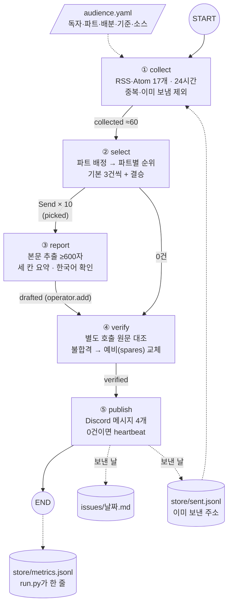
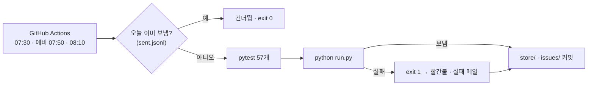
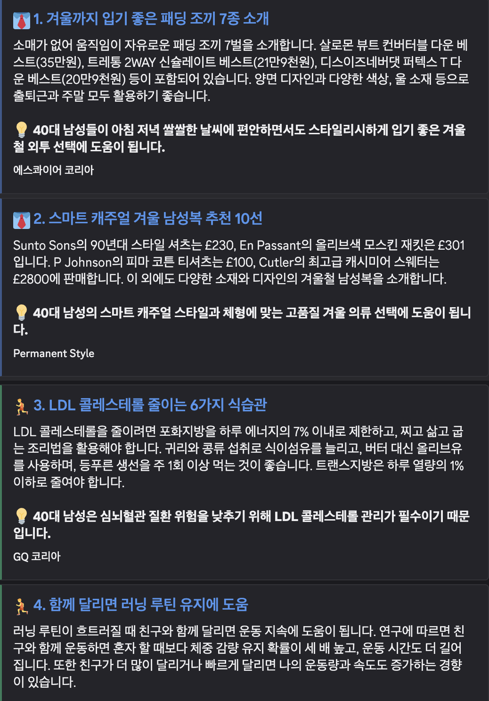

# REPORT · 40대 남성 아침 브리핑

> 매일 07:30(KST), 지난 24시간 기사 약 60건 중 40대 남성에게 쓸모 있는 10건을 남성복·스포츠·화장품으로 나눠 골라 한국어로 요약하고 Discord로 보내는 LangGraph 에이전트예요.
> 저장소: https://github.com/Lightnine999/my-newsletter-agent · 진행 기록 전체: [docs/plan.md](docs/plan.md) · 요구사항: [PRD.md](PRD.md)

| 항목 | 결과 |
|---|---|
| 노드 | collect → select → report(기사별 병렬) → verify → publish |
| 소스 | 검토 22개 항목(+대체 피드) → 채택 매체 14곳 · 피드 17개 |
| 하루 처리량 | 수집 약 60건 → 10건 발행 (실행 1회 58초 · 토큰 약 5만 개 · 약 $0.026) |
| 테스트 | 57개 (실제 API·네트워크 없이 돌아요) |
| 자동 실행 | GitHub Actions 07:30 + 예비 07:50·08:10 |

---

## 1. 분야 및 독자 정의

**왜 이 분야인가.** 40대 남성이 실제로 챙기는 정보(출근 옷차림, 체지방·관절 관리, 운동 뒤 피부 관리)는 해외 남성지·러닝지·그루밍 매체에 흩어져 있어요. 그런데 그 피드의 대부분은 연예 화보, 프로 경기 결과, 쇼핑 딜, 데이팅 글, 1020 트렌드예요. 실측에서도 24시간 60건 중 16~22건이 이런 이유로 빠졌어요. "내 나이와 생활에 맞는 것만 매일 10건"이 필요한 분야라고 봤어요.

**독자 페르소나** (`sources-master.docx` 1장 → [audience.yaml](audience.yaml) `audience`)

| 항목 | 내용 |
|---|---|
| 누구 | 출퇴근과 주말을 함께 챙기는 40대 남성 (Young Forty / Active Forty) |
| 옷 | 정장보다 스마트 캐주얼·비즈니스 캐주얼, 클래식 캐주얼, 아웃도어·고프코어 |
| 몸 | 러닝·수영·필라테스·요가·근력, 골프·테니스, 등산·캠핑, 하이록스·피클볼. 대사량이 줄고 관절·회복이 신경 쓰이는 나이 |
| 피부 | 잔주름·탄력 관리, 야외 운동 전후 자외선·열감 케어, 저자극 면도, 두피, 향수 |

**파트 세 개와 하루 10건.** docx의 네 섹션을 독자가 매일 같은 자리에서 찾을 수 있게 세 파트로 묶었어요.

| 파트 | 다루는 것 |
|---|---|
| 👔 남성복 | 출근·주말 겸용 스마트 캐주얼, 소재·컬러·신발 조합 |
| 🏃 스포츠 | 운동 루틴·부상 예방·장비 (docx의 '다이어트·워터/로드 루틴'과 '필드·코트·아웃도어'를 합침) |
| 🧴 화장품 | 안티에이징 성분, 운동 전후 케어, 쉐이빙, 두피, 향수 |

파트마다 3건씩 기본으로 받고, **남은 1건은 그날 가장 좋은 후보가 있는 파트**가 가져가요. 화장품처럼 후보가 모자라는 날에는 그 빈자리도 다른 파트가 채워요(3장).

---

## 2. 소스 채택표

**길 고르기.** 다섯 길(공식 API · RSS/Atom · 공개 데이터셋 · 집계 서비스 · 직접 스크래핑) 중 **RSS·Atom 피드**를 골랐어요. 패션·뷰티 매체는 공개 API가 없고, 아침 브리핑은 "새로 올라온 글"이 재료라 시간순 피드가 맞아요. 스크래핑은 목록 수집에 쓰지 않고, 고른 기사의 본문만 trafilatura로 뽑아요.

**관문 세 개.** G1 본문(원문에서 600자 넘게 뽑히나) · G2 생존(최근에도 글이 올라오나) · G3 접근(403·404·410, robots.txt). 막힌 곳은 우회하지 않아요.

측정: 2026-10-29. "24h"는 16:31 KST 기준 24시간 글 수예요(7일은 같은 날 16:03 기준). G1은 실제 기사 1건 이상의 본문 추출 길이예요.

### 채택 (매체 14곳 · 피드 17개)

| 매체 (docx 순위) | 피드 | 파트 | 24h | 7일 | G1 본문 | G2 | G3 | 근거 |
|---|---|---|---|---|---|---|---|---|
| Permanent Style (P1-2) | `/feed` | 남성복 | 1 | 3 | 10,423자 | 주 2~3건 | 허용(GPTBot만 차단) | 글은 적지만 테일러링 밀도가 높아요 |
| 에스콰이어 코리아 (P1-3, P2-1) | `/rss` | 섞임 | 11 | 11+ | 3,225자 | 통과 | 허용 | 패션·그루밍 외 연예가 섞여 select가 파트를 정해요 |
| GQ 코리아 (P1-4) | `/feed/` + style·fitness·grooming 카테고리 | 섞임+파트별 | 15 | — | 1,313~2,660자 | 통과 (grooming 피드는 6주 10건) | 허용(AI 학습 크롤러만 차단) | docx 링크(두산매거진)엔 피드가 없어 gqkorea.co.kr로 찾아 **복구** |
| Men's Health (P1-5, P2-5) | 미국판 fitness·grooming | 스포츠·화장품 | 4 | 50 | 5,630~6,635자 | 통과 | 허용 | docx의 호주판 전체 피드가 처음엔 0건이라 미국판 카테고리 피드로 바꿨어요 |
| Men's Health AU | `/category/fitness/feed/` | 스포츠 | 0 | 8 | 미측정 | 주 8건 | 허용 | 재점검 때 피드가 살아 있어 **복구** |
| Runner's World (P1-6) | `/rss/all.xml/` | 스포츠 | 12 | 49 | 6,380~14,602자 | 통과 | 허용 | 러닝 주제가 가장 풍부해요. 여성 전용·경기 결과는 제외 |
| Outside Online (P1-7) | `/feed/` | 스포츠 | 8 | 10 | 14,445자 | 통과 | 허용 | 기어 리뷰와 재난 뉴스가 섞여요 |
| 골프매거진코리아 (P1-8) | `/rss` | 스포츠 | 4 | 19 | 4,171자 | 통과 | 허용 | 투어 결과가 대부분이라 라이프스타일 글만 남아요 |
| SwimSwam (P1-11) | `/training/feed/` | 스포츠 | 0 | 주 5 | 6,051자 | 통과 | 허용 | 전체 피드 7일 10건이 모두 대회·리크루팅이라 훈련 피드로 바꿨어요 |
| Backpacker (P1-12) | `/feed/` | 스포츠 | 2 | 10 | 6,721자 | 통과 | 허용 | 사고 뉴스 제외 |
| Robb Report (P2-7) | `/style/grooming/feed/` | 화장품 | 0 | — | 2,635자 | **주의** (한 달 1건 남짓) | 허용 | 전체 피드 7일 10건이 자동차·부동산 경매라 그루밍 피드로 바꿨어요 |
| 아모레퍼시픽 스토리 (P2-9) | `/feed/` | 화장품 | 3 | 9 | 1,299~5,515자 | 통과 | 허용 | 보도자료가 많고 성분 칼럼이 쓸모 있어요 |
| FashionBeans (P2-10) | `/feed/` | 섞임 | 0 | 30 | 6,924~13,326자 | 통과 (하루에 몰아서 올림) | 허용 | 데이팅·픽업 글이 많아 제외 기준이 필요해요 |

### 탈락·보류

| 매체 (docx 순위) | 측정 | 걸린 관문 | 판단 |
|---|---|---|---|
| Racquet Magazine (P1-10) | 피드 정상, 본문 484자, 7일 2건 | G1 · G2 | 보류 (다른 글로 다시 잴 가치는 있어요) |
| Gentleman's Journal (P2-8) | 피드 404, 사이트맵 허용(영어 기사 11,924개)이지만 마지막 갱신 10-20 | G2 | 보류 (사이트맵 길로는 넣을 수 있어요) |
| AskMen (P2-6) | `/feed`는 10건 응답, 그런데 robots.txt가 ChatGPT-User·GPTBot·Claude 계열을 명시 차단 | G3 | 탈락 — 본문을 OpenAI로 요약하는 용도를 사이트가 거부했어요 |
| MR PORTER (P1-1, P2-2) | 피드 없음, robots.txt·사이트맵 403 | G3 | 탈락 |
| Golf Digest (P1-9) | 피드·robots.txt·사이트맵 403 | G3 | 탈락 |
| 화해 (P2-3) | robots.txt가 랭킹 경로(`/hwahae-rank`) 금지 | G3 | 탈락 |
| 올리브영 맨즈에딧 (P2-4) | robots.txt 403 | G3 | 탈락 |

**합계:** 24시간 60건. 파트로 나누면 쓸 만한 후보가 남성복 3~9 · 스포츠 21~31 · 화장품 1~4건이에요. **화장품이 가장 빠듯해요.**

---

## 3. 선별 로직 설계

### 중요도 판단 문장 ([audience.yaml](audience.yaml) `criteria`)

1. 오늘 옷차림·운동·관리에 바로 쓸 수 있나
2. 40대 몸(대사량·관절·회복·피부 탄력)에 맞나
3. 새 제품·성분·연구처럼 실제로 바뀐 게 있나
4. 단기간 몸 만들기·과장된 제목보다 오래 이어 갈 수 있는 습관·부상 예방·회복을 높게
5. 제품만 늘어놓은 쇼핑 목록보다 고르는 기준이나 쓰는 법을 알려 주는 글을 높게

4·5번은 실측 뒤에 더했어요. 처음엔 '28일 만에 식스팩' 같은 제목이 스포츠 1~2위에 올랐어요.

제외 조건(`exclude`): 연예인 화보·애장품, 프로 경기 결과·이적, 데이팅·선물 리스트·세일 딜, 여성 전용 제품, 1020 스트리트 트렌드, 부동산·자동차 경매, 사고·재난 뉴스, 기업 수상·홍보 보도자료.

### 예선 / 본선 2단계와 묶음 크기

```
약 60건 ─ ① 파트 배정 (40건씩 묶음) ─→ 👔 / 🏃 / 🧴 / 제외
            │
            ├─ ② 파트별 본선: 후보를 한 화면에 놓고 전부 순위 (같은 사건은 same_as로 묶음)
            │     └ 후보가 40건을 넘으면 예선: 40건씩 묶어 묶음마다 8건 → 본선
            │
            ├─ ③ 기본 몫: 후보가 적은 파트부터 한 건씩 돌아가며 3건씩  ← 코드(규칙)
            └─ ④ 결승: 파트별 다음 순위를 모아 한 번 더 순위 → 남은 자리   ← LLM + 코드
                  └ 그래도 자리가 남으면 파트별 순위를 따라 끝까지 채움
```

| 설정 | 값 | 이유 |
|---|---|---|
| 묶음 크기 `BATCH` | 40 | 긴 목록의 가운데는 LLM이 덜 본다(lost in the middle). 40건이면 제목·매체·요약 120자가 한 화면에 들어가고, 24시간 60건은 묶음 2개로 끝나요 |
| 예선 통과 `PRELIM_KEEP` | 묶음당 8 | 파트 하나에 최대 5건이 가니 묶음마다 그보다 넉넉하게 남겨요. 실측에서 스포츠 후보가 21~31건이라 지금은 예선 없이 본선만 돌아요 |
| 기본 몫 | 파트당 3 | 독자가 매일 세 파트를 다 보게 |
| 파트 상한 | 5 | 한 파트가 반을 넘지 않게 |
| 매체 상한 | 파트 안 2 · 전체 3 | 실측에서 Runner's World·Men's Health가 수집량의 절반 가까이였어요 |
| 결승 | `bonus: best` | "중요한 파트에 1건 더"를 고정 파트가 아니라 그날 후보 질로 정해요. `bonus: sports`처럼 고정할 수도 있어요 |

**순위는 LLM, 배분은 코드.** 배분 규칙(`allocate`)은 LLM 없이 코드로만 돌아서 테스트로 증명할 수 있어요. 화장품 후보가 1건뿐이면 나머지 9건을 다른 파트가 채우는지, 매체 상한을 지키는지 같은 규칙을 테스트 11개로 고정했어요.

### 검증 (같은 60건으로 실제 OpenAI를 반복 실행)

| 검사 | 결과 |
|---|---|
| 건수 | 매번 10건 |
| 파트 정확도 | 손으로 고른 0호 10건이 모두 맞는 파트로 배정됐어요(GQ STYLE 피드의 각질 기사도 화장품으로) |
| 쏠림 | 파트 안 같은 매체 2건 이하 · 전체 3건 이하 |
| 재현 | 두 실행 공통 9/10 |
| 0호와 겹침 | 7/10 |

### 선별을 고친 기록

| 증상 | 원인 | 고친 것 |
|---|---|---|
| 화장품이 2건만 뽑힘 | 남성복부터 몰아 채워서, 남성복·스포츠가 GQ 상한 3건을 먼저 씀 | 후보가 적은 파트부터 한 건씩 돌아가며 채움 |
| 하루 8건만 나옴 | LLM이 "남성 그루밍" 같은 뭉뚱그린 사건 라벨을 붙여 다른 기사를 같은 사건으로 지움 | 라벨 대신 `same_as`(같은 사건을 다룬 앞 순위 기사 번호)만 받음 |
| 재현 6/10 | temperature 0이어도 결과가 흔들림 | `seed` 고정 → 9/10 |
| 9건에서 멈춤 | 결승 후보끼리 같은 매체라 하나를 뽑으면 나머지가 막힘 | 결승 뒤에도 파트별 순위를 따라 끝까지 채움 |

---

## 4. 파이프라인 구조도



**State (`Brief`)**

| 칸 | 쓰는 노드 | 내용 | 리듀서 |
|---|---|---|---|
| `hours` | 시작 | 수집 범위 24 | — |
| `collected` | collect | 수집한 기사 (출처·피드 파트·주소 키) | — |
| `picked` | select | 고른 10건 (파트·기본/결승 표시) | — |
| `spares` | select | 고르지 않은 다음 순위 최대 6건 | — |
| `drafted` | report | 세 칸 요약 + 본문 (워커들이 동시에 씀) | `operator.add` |
| `verified` | verify | 검수 통과 + 교체분 | — |
| `log` | 모든 노드 | 단계별 한 줄 | `operator.add` |

**자동 실행**



멈춤 감지는 세 겹이에요. ① 보내야 하는데 못 보내면 exit 1(실패 메일) ② 0건이어도 "오늘은 조용합니다"를 보내서, 아무것도 안 온 날 = 멈춘 날 ③ Actions 실행 목록 훑기.

---

## 5. 실행 기록

### Discord 발행 화면

> **캡처를 추가해야 해요.** 새 채널(`40대 아침 브리핑`)에 2026-10-29 실제로 보낸 메시지 4개를 캡처해 `docs/images/discord-2026-10-29.png`로 저장하면 아래에 보여요.



같은 내용의 사본: [issues/2026-10-29.md](issues/2026-10-29.md)

### 실행 로그

**첫 실제 발송 (2026-10-29 오후, 로컬 `DRY_RUN=0 python run.py`)**

```
② 선별   60 → 후보 👔 9 · 🏃 31 · 🧴 4 · 제외 16 → 10건 (👔 2 · 🏃 4 · 🧴 4) · 부족: menswear 2/3
④ 검수   10 → 10건
   사본 issues/2026-10-29.md
⑤ 발행   10건 (👔 2 · 🏃 4 · 🧴 4) · 메시지 4개 · 보냄
```

**GitHub Actions 손 실행 (dry-run, [run 40873211829](https://github.com/Lightnine999/my-newsletter-agent/actions/runs/40873211829))**

```
57 passed
② 선별   61 → 후보 👔 9 · 🏃 29 · 🧴 1 · 제외 22 → 10건 (👔 4 · 🏃 5 · 🧴 1) · 부족: grooming 1/3
④ 검수   10 → 10건
⑤ 발행   10건 (👔 4 · 🏃 5 · 🧴 1) · 메시지 4개 · dry-run
   기록 store/metrics.jsonl · 58초 · 토큰 49654 · $0.0256
[main 1e11c54] 기록: 2026-10-29 브리핑
```

### [store/metrics.jsonl](store/metrics.jsonl)

| 날짜 | 실행 | 수집 | 배분 (👔·🏃·🧴) | 발행 | 결과 | 토큰 | 비용 |
|---|---|---|---|---|---|---|---|
| 2026-10-29 | 로컬 첫 발송 | 60 | 2 · 4 · 4 | 10 | 보냄 | — | — |
| 2026-10-29 | Actions 손 실행 | 61 | 4 · 5 · 1 | 10 | dry-run | 49,654 | $0.0256 |

첫 발송은 metrics 기능을 넣기 전이라, 로그와 `sent.jsonl`로 확인되는 값만 재구성했어요(`note` 칸에 표시, 모르는 값은 null). 매일 07:30 실행부터는 Actions가 한 줄씩 쌓아요.

### 검수 시험

| 시험 | 결과 (2회 반복) |
|---|---|
| 실제 요약 10건 | 10/10 통과 · 10/10 통과 |
| 숫자 바꿈 (프라다 8~9시간 → 12시간) | 잡음 · 잡음 |
| 없는 제품 넣음 (니베아 쉐이빙 폼) | 잡음 · 잡음 |
| 원문 오류 옮김 (좋은·나쁜 콜레스테롤 뒤바꿈) | 잡음 · 잡음 |

---

## 6. 프로젝트 회고

### 가장 공들인 부분

**"파트마다 3건 + 결승 1건"을 규칙으로 증명하기.** LLM에게 "10건을 골라"라고 하면 그날 어떤 파트가 몇 건 나올지 아무도 장담할 수 없어요. 순위만 LLM에게 맡기고 배분은 코드(`allocate`)로 빼서, "화장품이 1건뿐인 날에도 10건이 나온다", "같은 매체는 3건까지"를 테스트로 고정했어요. 그리고 실제 데이터로 반복 실행해서 테스트가 못 본 버그 네 개(3장 표)를 찾아, 하나씩 실패하는 테스트로 재현한 뒤 고쳤어요.

**실측으로 소스 정하기.** docx의 22개 항목을 "괜찮아 보이는 곳"으로 고르지 않고 피드 응답·24시간 건수·본문 추출 길이·robots.txt로 쟀어요. 처음에 뺀 10곳도 다시 확인해서 GQ 코리아와 Men's Health AU를 살렸어요. 피드가 있어도 robots.txt로 AI 에이전트를 막은 AskMen은 넣지 않았어요.

**조용히 틀리지 않게.** 실패가 성공처럼 보이는 지점을 막는 데 시간을 많이 썼어요.
- 보내야 하는데 못 보내면 exit 1로 끝내서 Actions가 빨간불이 돼요.
- 0건인 날에도 heartbeat를 보내요.
- 검수 호출이 실패하면 그 기사를 통과시키지 않아요.
- 테스트가 실제 API·Discord·파일을 건드리지 못하게 conftest로 막았어요(실제로 테스트가 OpenAI를 부르고 `output/`에 파일을 쓰던 걸 발견했어요).
- `gh secret set`이 `.env`를 못 찾고도 빈 값을 "성공"으로 등록한 일이 있어서, 빈 값이면 아무것도 등록하지 않는 스크립트로 바꿨어요.

### 보완하고 싶은 점

| 문제 | 근거 | 다음에 할 일 |
|---|---|---|
| 화장품 후보 부족 | 24시간 쓸 만한 후보 1~4건, Actions 실행에서 `부족: grooming 1/3` | 국내 남성 그루밍 매체를 찾아 같은 관문으로 재기. 보류한 Gentleman's Journal을 사이트맵 길로 넣기 |
| 검수가 조건 단정을 못 잡음 | GQ 각질 요약이 "면도하는 날엔 쓰지 말라"고 단정했는데(원문: 면도 안 하는 날에, 아침 면도면 밤에도 됨) 지시문에 예시를 넣어도 2번 다 통과 | report 지시를 다듬고, 건강 조언 문장만 따로 대조하는 검수 단계 시험 |
| GQ 쏠림 | GQ는 피드 4개로 하루 15건 → 남성복 후보 대부분이 GQ라 `부족: menswear 2/3`이 나온 날이 있음 | 일주일 metrics로 매체 상한·파트 상한 조정 |
| 원문 자체 오류 | GQ 콜레스테롤 기사 본문에 LDL·HDL을 뒤바꾼 문장이 있는데 스포츠 1위로 뽑힘 | 검수가 원문 오류를 그대로 옮긴 요약은 잡지만, 원문이 틀린 기사를 고르는 것 자체는 못 막아요. 건강 수치 기사는 출처를 한 번 더 보는 규칙 검토 |
| 파트 배정 흔들림 | 같은 입력에서 화장품 후보 3 ↔ 4건 | 경계선 기사(제품 출시 보도자료 등)의 기준을 `exclude`에 더 구체적으로 |
| 지표가 아직 하루치 | metrics 2줄 | 일주일 운영 후 발송 성공률·평균 지연·파트별 배분 분포·하루 비용을 이 보고서에 추가 |
